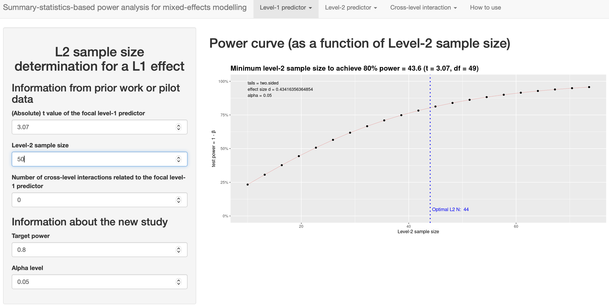

```{r}
library(knitr)                
library(tidyr)                # tidy data
library(dplyr)                # data wrangling
library(ggplot2)              # create figures
library(kableExtra)           # create tables
library(purrr)                # perform iterative tasks
library(faux)                 # simulate factorial data
library(broom)                # tidy statistical results
library(emmeans)              # pairwise comparisons
library(lme4)                 # linear mixed models
library(pwr)                  # conduct power analyses
```

## (General) Linear Mixed Models

Linear mixed models are used when data is nested, meaning there are multiple observations for each participant under one or more conditions. For example, in a study investigating the effect of sleep deprivation, two groups of participants (sleep-deprived vs. control) could be measured repeatedly on reaction time across a week. Because measurements are repeated within participants, observations are not independent. Linear mixed models handle the correlation among repeated measurements and provides more accurate estimates than traditional methods like *t*-tests or repeated measures ANOVA [@brysbaert_LMEM]. For a gentle introduction to general linear mixed models, readers are referred to Brysbaert et al. [-@brysbaert_LMEM] and Brown [-@brown2021].

### Summary-statistics-based approach

Murayama et al. [-@murayama2022] created an app to run power analyses of mixed-effects models with two-level nested data available at <https://koumurayama.shinyapps.io/summary_statistics_based_power/>. Their approach relies on the fact that mixed-effects models produce approximately identical results to a simpler statistical test (e.g., one-sample *t*-test) on aggregated data under certain assumptions (i.e., cluster size and the variance of *x* are constant across clusters). To illustrate this, suppose that a researcher collects 10 data points (Level 1; L1) nested within 50 participants (Level 2; L2). For each participant, 5 data points are from a control condition (sleep deprived) and 5 data points are from an experimental (sleep deprived + caffeine) condition (see @fig-figure10).

```{r}
#| label: fig-figure10
#| fig-cap: "Simulated pattern of means for the 2 (condition) x 5 (time) within-subject design."
# For reproducibility
set.seed(050990)

# Set parameters
n <- 50
mu <- c(10, 10.2, 10.3, 10.5, 10.5,
        10.9, 11, 11.5, 11.2, 11.6)
sd <- 3
r <- 0.8

# Simulate data
design <- sim_design(
  within = list(
    time = c("post1", "post2", "post3", "post4", "post5"),
    condition = c("control", "caffeine")
    ),
  n = n,
  mu = mu,
  sd = sd,
  r = r,
  plot = TRUE,
  long = TRUE
  )
```

The first step is to calculate the average of the measurements for each experimental condition:

```{r}
df <- design |> 
  group_by(id, condition) |> 
  summarise(average = mean(y), .groups = "drop") 

df_wide <- df |> 
  pivot_wider(
    names_from = condition, 
    values_from = average)
```

The second step is to calculate the t-statistic using `t.test(paired = TRUE)`:

```{r}
paired_result <- t.test(
  df_wide$control, 
  df_wide$caffeine, 
  paired = TRUE
  ) |> 
  tidy()

paired_result |> 
  kable(digits = 4) |> 
  kable_styling()
```

This is statistically equivalent to running a mixed model with one fixed effect and with one random effect using `lmer()`. Since `lme4::lmer()` does not provide *p*-values, we use `lmerTest::lmer()` instead.

```{r}
# Change order of factors to obtain the same estimate (i.e., -0.5 rather than 0.5)
df$condition <- factor(df$condition, levels = c("caffeine", "control"))

fit <- lmerTest::lmer(average ~ condition + (1|id), df) |> 
  summary()

fit$coefficients |> 
  kable(digits = 4) |> 
  kable_styling()
```

Note that both `t.test()` and `lmer()` approaches return the same coefficient, *t*-statistic and *p*-value indicating that these two analytic approaches are equivalent. In fact, when the two aforementioned conditions are met (i.e., cluster size and the variance of *x* are constant across clusters), mixed-effects modelling and summary-statistics (i.e., *t*-test) approach are mathematically equivalent.

Once we obtain the *t*-value, we need to convert the *t-*value to Cohen’s *d* as if the *t-*value were obtained from a one-sample *t-*test with the sample size. This Cohen’s *d* can be then used to conduct a power analysis of one-sample *t*-test with *G\*Power*, *pwr*, or other software.

```{r}
# Compute Cohen's dz
d <- paired_result$statistic / sqrt(n) 

# Conduct power analysis
pwr <- pwr.t.test(d = d, power = 0.8, sig.level = 0.05, type = "one.sample")
pwr
```

Assuming a true effect size of `r round(d, 2)`, our study design would achieve a power of `r pwr$power*100`% with a sample size of `r ceiling(pwr$n)`.

Alternatively, readers can use the app (<https://koumurayama.shinyapps.io/summary_statistics_based_power/>) to reproduce the above power analysis (see @fig-figure11).

```{r}
#| label: fig-figure11
#| fig-cap: "A priori power analysis to estimate sample size for L2 based on the summary-statistic approach"

```

::: callout-important
-   The app only provides power estimates of mixed-effects models with two-level nested data (not the models with three-level data or crossed-random effects).

-   This app mainly allows researchers to perform power analysis to determine L2 sample size. The app can still show the impact of cluster size on power, but you need to supply more information beyond the summary statistic and sample size.

-   Computed power is based on the assumption that the new study has the same set of predictors as assumed in the calculation.

-   When planning only a L2 sample size for a new study, the estimated appropriate L2 sample size is deemed valid only if cluster size (i.e., the number of individual units within each cluster) remains the same as assumed in the calculation.
:::

Power analysis for mixed models using simulations can be challenging because it requires additional information, including:

-   The design to be used (as for other power analyses)

-   The anticipated effect size or the mean condition difference (as for other power analyses)

-   Estimates of the relevant variance components (i.e., random intercept and slope).

-   The anticipated numbers of participants (as for other power analyses) and observations per condition.

### Traditional approach (work in progress)

Westfall et al. [-@westfall2014] created an app to run power analyses for simple designs with one fixed effect and two random factors. The app is available at <https://jakewestfall.shinyapps.io/crossedpower>.

### Simulation-based power analysis (work in progress)

An alternative is to use simulation-based power analysis. For a comprehensive tutorial on this approach, readers are referred to Debruine and Barr [-@debruine_mixedeffects].
