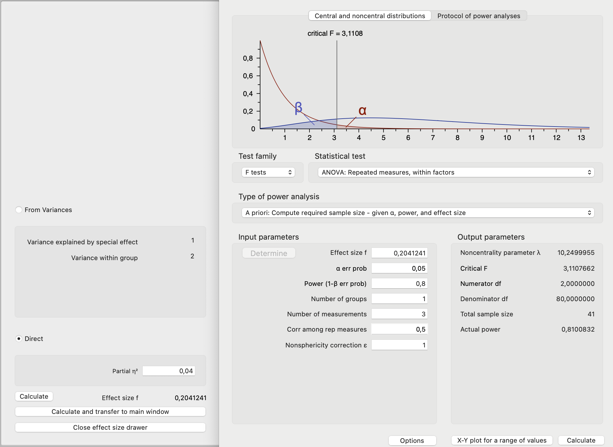
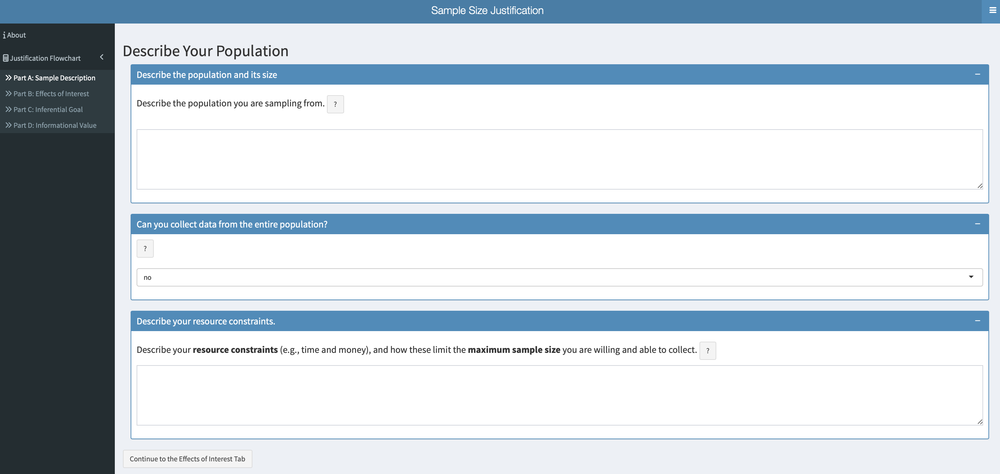
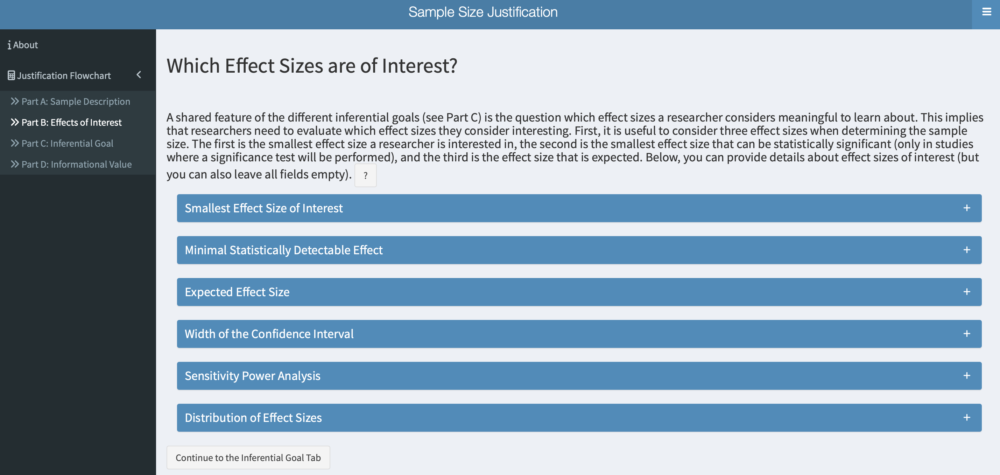
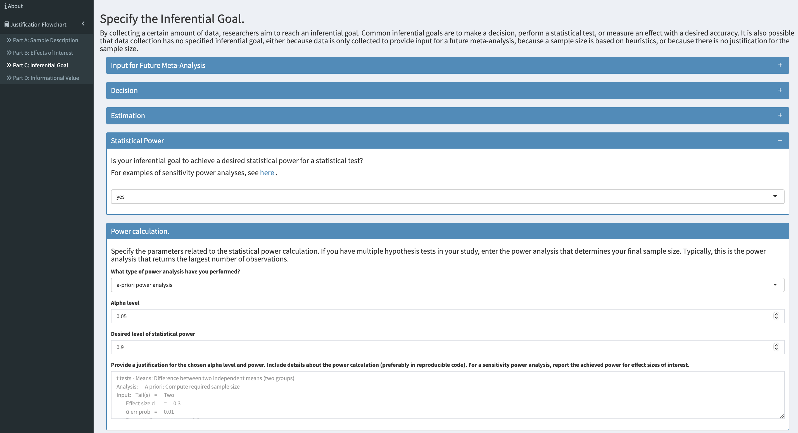
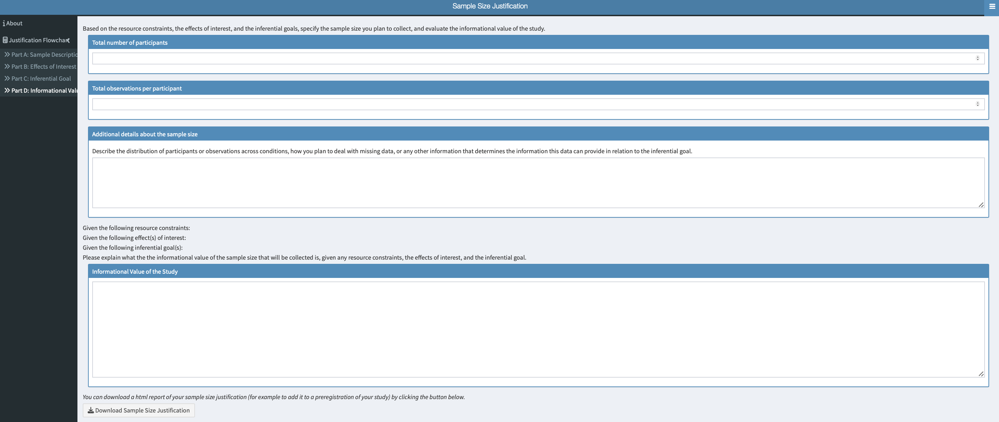

# Transparency and computational reproducibility

```{r}
library(knitr)  
```

A priori power analyses are often not reproducible because researchers frequently fail to provide all the necessary information [@thibault_2022; @thibault_2024; @bakker_quality_poweranalysis]. This lack of transparency not only prevents peers' from reproducing the analyses, but also limits their ability to evaluate the analytic decisions made by researchers or assess whether the a priori power analysis was performed correctly. Therefore, researchers must report all information required to reproduce the a priori power analysis including the test, alpha level, the type and magnitude of the effect size, and how it was derived if researchers had to compute it themselves. In such case, researchers should provide the corresponding formula and reference.

Transparency and reproducibility can be enhanced by sharing the analysis script. Therefore, researchers who use R should provide the script used to perform the power analysis. When G\*Power is used, a screenshot of the analysis output should be included.

```{r fig-figure12, fig.cap = "Screenshot of G*Power interface with all required information to reproduce the power analysis for a one-way within-subject design with three 3 dependent groups.", echo=FALSE, out.width = "100%"}

```

Besides providing the analysis script or a screenshot, researchers should justify all decisions made during the power analysis—such as the chosen effect size and any other assumptions (e.g., correlation between measurements).

To improve the sample size justification regardless of the approach, researchers are encouraged to use the [Sample Size Justification Shiny App](https://shiny.ieis.tue.nl/sample_size_justification/) which offers step-by-step guidance for reporting a priori power analyses and other types of sample size justification. Researchers should transparently justify the chosen effect size. Before using the app, readers are encouraged to read Lakens [-\@ @lakenssamplejustification]. Briefly, the [Sample Size Justification Shiny App](https://shiny.ieis.tue.nl/sample_size_justification/) covers the following steps:

1.  Describe the population of interest and resource constraints. Clicking on "?" provides a detailed description of each question.

```{r, fig-figure13, fig.cap = "Part A - Describe your population.", echo = FALSE, out.width = "100%", fig.height = 4}

```

2.  Justify the effect size of interest based on the following categories:

```{r, fig-figure14, fig.cap = "Part B - Justify which effect ssizes they consider meaningful to learn about.", echo = FALSE, out.width = "100%"}

```

3.  Specify your inferential goal. If your goal is to achieve a desired level of power, you should perform an a priori power analysis that includes all necessary details and ideally provided as reproducible code.

```{r, fig-figure15, fig.cap = "Part C - Specify the inferential goal.", echo = FALSE, out.width= "100%"}

```

4.  Specify the total number of participants, observations per participant and explain the informational value of the planned study. Researchers can then download the the report as an html file so that it can be added as part of the preregistration of the study.

```{r, fig-figure16, fig.cap = "Part D - Explain the informational value of the planned study.", echo = FALSE, out.width = "100%"}

```
